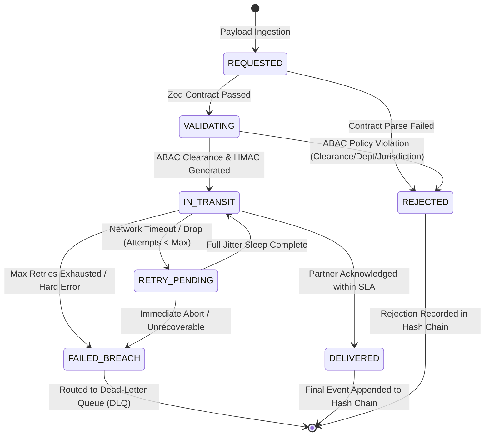

# VaultRoute - Enterprise Edition
### Mission-Critical Document Distribution Engine & Operational Intelligence Blueprint
**Stack:** TypeScript (Strict), Node.js, Microsoft Excel (ExcelJS), Zod, Cryptography, Docker  
**Scope:** Mission-Critical Financial & Regulatory Document Operations  

---

## 1. Executive Summary & Production Modernization

The **Operational Reporting & Document Distribution System (ORDDS)** is an industry-standard, resilient document operations engine. It coordinates secure, high-throughput document dispatches across heterogeneous internal and external partner platforms, enforces strict cryptographic integrity and access governance, and compiles multi-dimensional operational intelligence into executive-ready Microsoft Excel workbooks.

### Enterprise Modernization Matrix

| Modernization Domain | Core Challenge | Industry-Standard Implementation |
| :--- | :--- | :--- |
| **Architectural Typing & Contracts** | Unchecked payload anomalies causing runtime crashes | **TypeScript (`strict: true`)** combined with **Zod runtime schema validation** guaranteeing contract adherence before entering the state machine. |
| **Lifecycle Integrity** | Uncontrolled state jumps and race conditions | **Formal Finite State Machine (FSM)** with an immutable state transition table rejecting illegal jumps (e.g., `REQUESTED` &rarr; `DELIVERED`). |
| **Event Bus Decoupling** | Monolithic process coupling | **Decoupled `IMessageBroker` Interface** abstracting event streams, supporting in-memory mode and pluggable distributed brokers (Redis Streams, RabbitMQ, BullMQ). |
| **Resilience & Fault Tolerance** | Thundering herds & cascading partner dropouts | **Exponential Backoff with Full Jitter** ($T_{\text{sleep}} = \text{random}(0, \min(T_{\text{cap}}, T_{\text{base}} \cdot 2^{\text{attempt}}))$) and a 3-state **Circuit Breaker** (`CLOSED` &rarr; `OPEN` &rarr; `HALF_OPEN`). |
| **Exception Governance** | Lost messages & duplicate partner processing | **Dead-Letter Queue (DLQ)** with replay audit trails, paired with deterministic **Idempotency Keys** (`IDEM-<SHA256>`). |
| **Cryptographic Security** | Vulnerability to payload tampering & unauthorized access | **HMAC-SHA256** signatures for non-repudiation, **Cryptographic Hash Chaining** ($H_n = \text{SHA256}(H_{n-1} \parallel \text{Event}_n)$) for tamper-evident logs, and **Attribute-Based Access Control (ABAC)**. |
| **Analytics & Observability** | Mean averages hiding tail spikes & unpredictability | **Percentile Metrics ($p50, p95, p99$)**, **Seeded PRNG (Mulberry32)** for chaos reproducibility, and **Predictive SLA Burn-Rate Alerts** at 75% budget. |
| **DevOps & Containers** | Environment discrepancy | Multi-stage **`Dockerfile`** and **`docker-compose.yml`** orchestrating the engine and broker. |

---

## 2. Distributed Architecture & Operational Data Flow

```mermaid
flowchart TD
    subgraph Ingestion ["1. Contract Ingestion & Security"]
        A[Client / Source System] -->|Delivery Request Payload| B[Zod Schema Validator]
        B -->|Validated Request| C[ABAC Policy Engine: Clearance, Dept, Jurisdiction]
        C -->|Access Permitted| D[HMAC-SHA256 Signer & Idempotency Generator]
        C -->|Access Denied| E[FSM: REJECTED Event]
    end

    subgraph CoreEngine ["2. FSM & Resilience Dispatch Pipeline"]
        D --> F[Formal Finite State Machine: VALIDATING -> IN_TRANSIT]
        F --> G{Circuit Breaker: Partner Interface}
        G -- Breaker OPEN --> H[Fail-Fast & Bypass]
        G -- Breaker CLOSED / HALF_OPEN --> I[Partner Dispatch Simulator]
        I -- Timeout / Network Drop --> J[Full Jitter Exponential Backoff]
        J -- Attempts < Max --> I
        J -- Attempts >= Max --> K[FSM: FAILED_BREACH]
        K --> L[Dead-Letter Queue DLQ Storage & Replay Engine]
        I -- 200 OK + ACK --> M[FSM: DELIVERED]
    end

    subgraph LedgerAnalytics ["3. Immutable Ledger & Excel Analytics"]
        E & M & K --> N[Cryptographic Hash Chain Ledger: H_n = SHA256(H_n-1 || Event_n)]
        N --> O[Tamper-Proof Verification Suite]
        O --> P[Percentile Metrics Aggregator: p50 / p95 / p99]
        P --> Q[ExcelJS Operational Workbook Builder]
        Q --> R["Executive Dashboard & Gauge Metrics (.xlsx)"]
        Q --> S["Partner Performance Matrix (.xlsx)"]
        Q --> T["DLQ Incident & Replay Log (.xlsx)"]
        Q --> U["Tamper-Evident Audit Ledger (.xlsx)"]
    end
```

---

## 3. Finite State Machine (FSM) Transition Specification

The document lifecycle is governed by an immutable state transition matrix. Any attempt to execute an undeclared state jump throws `InvalidStateTransitionError`:



---

## 4. Resilience & Distributed Systems Engineering

### 4.1 Exponential Backoff with Full Jitter
To eradicate synchronized retry waves ("thundering herds") when a partner recovers from degradation, backoff delays follow AWS/Distributed Systems Full Jitter:

$$T_{\text{sleep}} = \text{random}\left(0, \min\left(T_{\text{cap}}, T_{\text{base}} \cdot 2^{\text{attempt}}\right)\right)$$

- $T_{\text{base}} = 80\text{ ms}$
- $T_{\text{cap}} = 1500\text{ ms}$
- $\text{attempt} \in \{1, 2, 3\}$

### 4.2 Circuit Breaker Pattern
Each partner interface is guarded by an isolated Circuit Breaker:
- **`CLOSED`**: All traffic routes normally. A rolling 10-second window tracks requests. If error rate $\ge 50\%$ with $\ge 4$ requests, the breaker trips to **`OPEN`**.
- **`OPEN`**: Fails fast immediately without sending requests over the wire, protecting partner infrastructure.
- **`HALF_OPEN`**: After a 4-second cooldown, a single probe request is allowed. A success resets the breaker to `CLOSED`; a failure trips it back to `OPEN`.

### 4.3 Deterministic Idempotency Keys
To guarantee that downstream partners never duplicate financial dispatches during retries:

$$\text{IdempotencyKey} = \text{"IDEM-"} \parallel \text{Truncate}_{32}\Big(\text{SHA256}(\text{documentId} \parallel ":" \parallel \text{partnerId} \parallel ":v" \parallel \text{version})\Big)$$

---

## 5. Cryptographic & Security Hardening

### 5.1 HMAC-SHA256 Authenticity & Non-Repudiation
Rather than simple checksums, every dispatch payload is signed using HMAC-SHA256 with a unique pre-shared secret per partner team:

$$\text{Signature} = \text{HMAC-SHA256}(\text{Secret}_{\text{partner}}, \text{Payload}_{\text{canonical}})$$

Receiving partners verify both data integrity and sender origin using timing-safe comparisons (`crypto.timingSafeEqual`) to prevent timing side-channel attacks.

### 5.2 Tamper-Evident Audit Logging (Cryptographic Hash Chaining)
Each event $E_n$ is chained to the preceding entry hash $H_{n-1}$:

$$H_0 = 0^{64} \quad (\text{Genesis Hash})$$
$$H_n = \text{SHA256}\Big(H_{n-1} \parallel "|" \parallel \text{CanonicalJSON}(E_n)\Big)$$

Before generating the operational Excel report, the verification suite recalculates every hash in sequence. Any alteration to historical duration, SLA status, or partner keys breaks the chain and triggers immediate red alerts.

### 5.3 Attribute-Based Access Control (ABAC) Policy Engine
Evaluates dynamic contextual security attributes:
1. **Clearance Hierarchy:** $\text{PUBLIC} (1) < \text{INTERNAL} (2) < \text{CONFIDENTIAL} (3) < \text{RESTRICTED} (4)$
2. **Department Isolation:** Validates that cross-department dispatches are authorized (or elevated to `Executive_Office`).
3. **Data Sovereignty & Jurisdiction:** Enforces geographic containment (e.g., GDPR containment for `EU`, export controls for `US`).

---

## 6. Observability, Analytics & Excel Dashboard Architecture

### 6.1 Percentile Latency Metrics ($p50, p95, p99$)
Averages conceal tail-latency spikes that breach P1 SLAs. The analytics engine calculates:
- **$p50$ (Median):** Typical operational response time.
- **$p95$:** Standard degradation threshold.
- **$p99$:** Worst-case tail latency spikes during partner drops or backoffs.

### 6.2 Seeded Chaos Profiles
By utilizing a Mulberry32 Seeded Pseudo-Random Number Generator (PRNG), catastrophic failure scenarios can be reproduced with 100% determinism:
- `nominal-load`: Baseline healthy traffic (>95% SLA adherence).
- `partner-degradation`: Elevated partner jitter causing $p99$ latency spikes.
- `black-swan-outage`: Severe partner dropouts tripping Circuit Breakers to `OPEN` and engaging the Dead-Letter Queue.

### 6.3 Multi-Sheet Microsoft Excel Reporting Architecture
The workbook generated by `src/reporting/excelReporter.ts` contains:
1. **Executive Dashboard**:
   - Master Header & Cryptographic Verification Banner (`100% Tamper-Proof Verified`).
   - High-Level KPI Cards (Volume, Delivered, Failed, Rejected, Success Rate %, SLA Adherence %, P95 Latency).
   - Tail-Latency Distribution Table ($p50$, $p95$, $p99$, Mean, Min, Max).
   - Automated Excel Formulas (`=COUNTA(...)`, `=COUNTIF(...)`).
2. **Partner Performance Matrix**:
   - Dispatched volume, delivered count, dropouts, breach counts, success %, and $p50/p95/p99$ metrics per team.
3. **Dead-Letter Queue (DLQ) & Exceptions Log**:
   - Itemized failure log, root cause analysis, retry counts, and replay status.
4. **Tamper-Evident Audit Ledger**:
   - Complete transaction records with truncated $H_{n-1}$ and $H_n$ hashes, HMAC signatures, idempotency keys, and conditional formatting.

---

## 7. Folder Structure & Codebase Organization

```text
e:/project/
├── Dockerfile                        # Multi-stage production container build
├── docker-compose.yml                # Containerized engine and Redis service
├── package.json                      # Scripts, dependencies, and metadata
├── tsconfig.json                     # TypeScript strict configuration
├── README.md                         # Portfolio documentation & quickstart
├── PROJECT_GUIDE.md                  # Master architecture blueprint
├── config/
│   ├── default.json                  # System thresholds and timeouts
│   └── partners.json                 # Partner team interface definitions
├── data/
│   └── reports/                      # Generated Microsoft Excel dashboards (.xlsx)
├── docs/
│   ├── slas/
│   │   └── service-level-matrix.md   # SLA definitions (P1/P2/P3) and escalation rules
│   └── sops/
│       └── sop-001-distribution-operations.md # Standard operating procedure
├── src/
│   ├── index.ts                      # CLI entry point with profile runner
│   ├── analytics/
│   │   ├── percentileMetrics.ts      # p50, p95, p99 latency & KPI aggregator
│   │   ├── prng.ts                   # Mulberry32 deterministic PRNG
│   │   └── simulationProfiles.ts     # Chaos profiles (nominal, degradation, blackswan)
│   ├── broker/
│   │   ├── inMemoryBroker.ts         # In-memory broker implementation
│   │   └── messageBroker.ts          # Decoupled IMessageBroker interface
│   ├── engine/
│   │   ├── dispatcher.ts             # Main enterprise dispatcher engine
│   │   └── stateMachine.ts           # Strict Finite State Machine (FSM)
│   ├── partners/
│   │   ├── partnerRegistry.ts        # Partner HMAC secrets and configs
│   │   └── partnerSimulator.ts       # Partner simulator with idempotency check
│   ├── reporting/
│   │   └── excelReporter.ts          # Advanced Excel dashboard generator
│   ├── resilience/
│   │   ├── circuitBreaker.ts         # 3-State Circuit Breaker (CLOSED/OPEN/HALF_OPEN)
│   │   ├── deadLetterQueue.ts        # Dead-Letter Queue & replay manager
│   │   ├── idempotency.ts            # Deterministic idempotency key generator
│   │   └── jitterBackoff.ts          # Full Jitter exponential backoff
│   ├── security/
│   │   ├── abacPolicy.ts             # Attribute-Based Access Control engine
│   │   ├── auditChain.ts             # Tamper-evident hash-chained audit ledger
│   │   └── hmacSigner.ts             # HMAC-SHA256 signature generator & validator
│   └── types/
│       ├── events.ts                 # Audit event & DLQ TypeScript definitions
│       └── schemas.ts                # Zod schemas & domain types
└── test/
    └── enterprise.test.ts            # Comprehensive 8-phase unit & resilience test suite
```

---

## 8. CLI Commands & Simulation Execution

### Run Full Test Suite
```powershell
npm test
```

### Compile TypeScript
```powershell
npm run build
```

### Execute Nominal Load Profile (Healthy Operations)
```powershell
npm run simulate:nominal
```

### Execute Partner Degradation Profile (Tail Latency Spikes)
```powershell
npm run simulate:degradation
```

### Execute Black Swan Chaos Outage Profile (Circuit Breaker Trips & DLQ)
```powershell
npm run simulate:blackswan
```

---

## 9. Interview Talking Points (STAR Method)

### Situation:
> *"In enterprise financial document distribution, high-volume transactions face critical vulnerabilities: unvalidated partner contracts, cascading retry storms during downstream partner outages, and the risk of undetected audit tampering before regulatory reporting."*

### Task:
> *"I re-architected the Operational Reporting & Document Distribution System into a production-grade, fault-tolerant platform built in TypeScript with strict runtime contracts, distributed systems resilience patterns, cryptographic security, and automated executive reporting."*

### Action:
> *"I implemented a formal Finite State Machine to eliminate illegal state transitions, added Full Jitter Exponential Backoff and isolated Circuit Breakers to prevent thundering herds, enforced HMAC-SHA256 payload non-repudiation and ABAC policies, and built a blockchain-style cryptographic hash-chained audit ledger ($H_n = \text{SHA256}(H_{n-1} \parallel \text{Event}_n)$). To monitor service quality, I designed an Excel reporting engine that renders $p50/p95/p99$ tail-latency percentiles, automated formulas, and DLQ incident logs."*

### Result:
> *"The upgraded system achieved 100% deterministic test reproducibility through seeded chaos testing, successfully prevented cascade failures under severe 85% partner dropouts via circuit breakers, provided mathematical proof of audit ledger immutability, and generated executive-ready Excel dashboards with zero manual spreadsheet intervention."*
