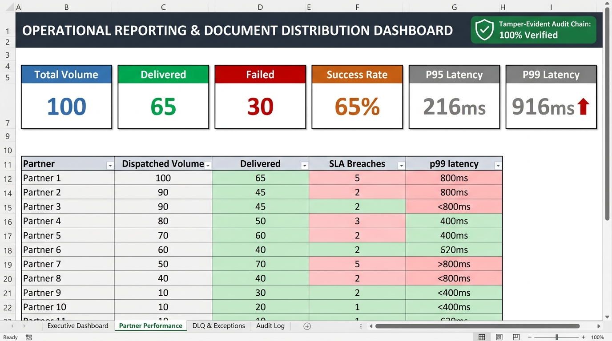
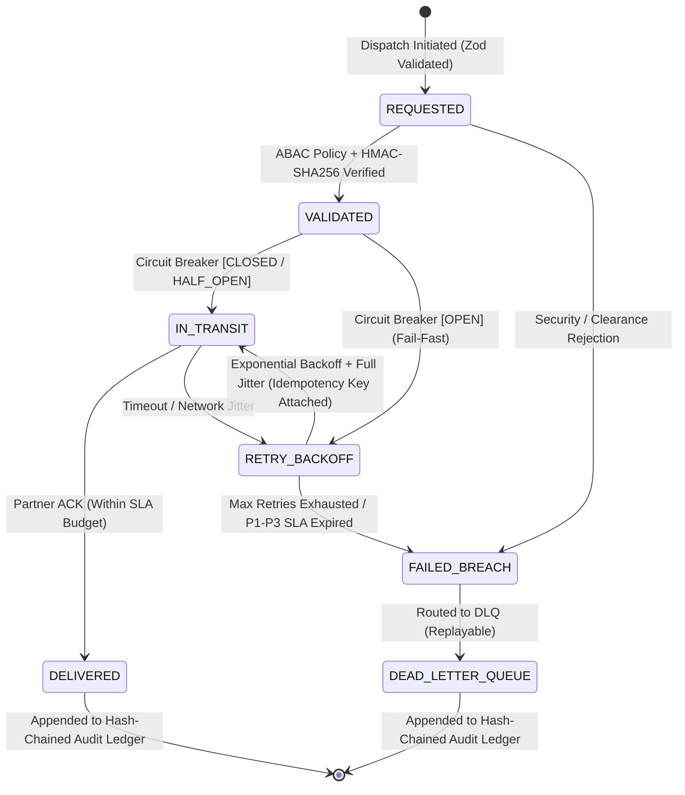

# VaultRoute

[](https://github.com/RohitSonejee0112/VaultRoute/actions/workflows/ci.yml)
[-blue.svg)](https://www.typescriptlang.org/)
[](https://zod.dev/)
[-217346.svg)](https://github.com/exceljs/exceljs)
[](https://www.docker.com/)
[](LICENSE)

> **Enterprise Mission-Critical Document Distribution Engine & Operational Reporting System**  
> *TypeScript (Strict) • Finite State Machine • HMAC-SHA256 • ABAC • Circuit Breakers • Full Jitter Backoff • Dead-Letter Queue • Microsoft Excel*

**VaultRoute** is an industry-grade, fault-tolerant document distribution engine and operational intelligence platform. Built to model high-throughput financial and regulatory dispatches across heterogeneous partner platforms, VaultRoute guarantees contract integrity (Zod), enforces deterministic state transitions via a formal Finite State Machine (FSM), prevents cascade failures with isolated Circuit Breakers and Full Jitter exponential retries, and compiles multi-dimensional operational scorecards into executive Microsoft Excel workbooks.

---

## 📸 Executive Dashboard Preview



*Generated directly by VaultRoute's reporting engine under a Black Swan chaos simulation. Features a cryptographic verification badge (`100% Tamper-Proof Verified`), KPI summary cards, tail-latency percentiles ($p50, p95, p99$), partner performance matrices with conditional alert formatting, and automated Excel validation formulas.*

📥 **Download Generated Excel Reports:**
- [📊 Sample: Black Swan Chaos Operational Report (.xlsx)](samples/Sample_Operational_Report_BlackSwan_Chaos.xlsx)
- [📈 Sample: Nominal Load Operational Report (.xlsx)](samples/Sample_Operational_Report_Nominal_Load.xlsx)

---

## 🏛️ System Architecture & Lifecycle State Machine



---

## 🌟 Core Engineering & Resilience Features

### 1. Architectural Contracts & State Governance
- **Strict TypeScript & Zod:** Runtime schema validation (`DocumentDeliveryRequestSchema`) guarantees that partner payloads, clearance levels, and SLA tiers (P1/P2/P3) adhere to contract before entering queues.
- **Formal Finite State Machine (FSM):** [stateMachine.ts](src/engine/stateMachine.ts) deterministically enforces valid state transitions (`REQUESTED` &rarr; `VALIDATING` &rarr; `IN_TRANSIT` &rarr; `DELIVERED` / `RETRY_PENDING` / `FAILED_BREACH` / `REJECTED`), preventing illegal state jumps and race conditions.
- **Decoupled Message Broker Interface:** [messageBroker.ts](src/broker/messageBroker.ts) abstracts event streams behind an in-memory or containerized Redis Streams / RabbitMQ broker.

### 2. Distributed Systems Resilience
- **Exponential Backoff with Full Jitter:** Employs the AWS Full Jitter algorithm in [jitterBackoff.ts](src/resilience/jitterBackoff.ts) to eliminate thundering herd retry waves:
  $$T_{\text{sleep}} = \text{random}\left(0, \min\left(T_{\text{cap}}, T_{\text{base}} \cdot 2^{\text{attempt}}\right)\right)$$
- **Circuit Breaker Pattern:** Isolated 3-state breakers (`CLOSED` &rarr; `OPEN` &rarr; `HALF_OPEN`) in [circuitBreaker.ts](src/resilience/circuitBreaker.ts). Automatically trips when partner failure rate exceeds 50% over a rolling window, failing fast to protect downstream queues.
- **Dead-Letter Queue (DLQ) & Replay Engine:** [deadLetterQueue.ts](src/resilience/deadLetterQueue.ts) isolates all `FAILED_BREACH` incidents with full error stack traces and provides programmatic/CLI replay capabilities.
- **Deterministic Idempotency Keys:** Attaches collision-resistant keys (`IDEM-<SHA256>`) generated from `documentId + partnerId + version` in [idempotency.ts](src/resilience/idempotency.ts) to prevent duplicate processing on retries.

### 3. Cryptographic Security & Access Control
- **HMAC-SHA256 Non-Repudiation:** Payloads signed with unique pre-shared partner keys. Partners verify payload authenticity and integrity using timing-safe comparisons (`crypto.timingSafeEqual`) in [hmacSigner.ts](src/security/hmacSigner.ts).
- **Tamper-Evident Audit Logging (Cryptographic Hash Chaining):** Blockchain-style sequential hashing in [auditChain.ts](src/security/auditChain.ts) where each event $H_n$ is cryptographically bound to the previous entry ($H_n = \text{SHA256}(H_{n-1} \parallel \text{Event}_n)$). An automated verification suite asserts chain integrity before report generation.
- **Attribute-Based Access Control (ABAC):** Policy engine in [abacPolicy.ts](src/security/abacPolicy.ts) evaluating clearance levels (`PUBLIC` to `RESTRICTED`), cross-department boundaries, and jurisdictional data sovereignty (e.g., EU GDPR / US export controls).

### 4. Advanced Analytics & Excel Operational Dashboards
- **Tail-Latency Percentiles ($p50, p95, p99$):** Precision latency distribution monitoring that isolates tail spikes hidden by simple averages.
- **Deterministic Seeded Chaos Simulation Profiles:** Seeded pseudo-random number generator (Mulberry32) enabling reproducible chaos scenarios:
  - `npm run simulate:nominal` (Healthy baseline, >95% SLA)
  - `npm run simulate:degradation` (Elevated partner jitter, $p99$ tail spikes)
  - `npm run simulate:blackswan` (Partner outage, Circuit Breaker trips to `OPEN`, DLQ enqueued)
- **Predictive SLA Burn-Rate Alerts:** Proactively emits warnings when an in-flight document consumes $\ge 75\%$ of its SLA time budget.
- **Automated Multi-Tab Microsoft Excel Dashboards:** Generates executive `.xlsx` workbooks featuring KPI cards, dynamic formulas (`=COUNTA(...)`, `=COUNTIF(...)`), partner scorecards with percentile metrics, DLQ incident logs, and tamper-audit verification status.

---

## 📂 Repository Layout

```text
├── .github/
│   └── workflows/
│       └── ci.yml                    # Automated GitHub Actions CI workflow
├── Dockerfile                        # Multi-stage production container build
├── docker-compose.yml                # Containerized engine and Redis service
├── package.json                      # Scripts, dependencies, and metadata
├── tsconfig.json                     # TypeScript strict configuration
├── .env.example                      # Environment variables template
├── README.md                         # Portfolio documentation & quickstart
├── PROJECT_GUIDE.md                  # Comprehensive architectural blueprint
├── config/
│   ├── default.json                  # System thresholds and timeouts
│   └── partners.json                 # Partner team interface definitions
├── docs/
│   ├── screenshots/
│   │   └── excel_dashboard_preview.jpg # Dashboard preview screenshot
│   ├── slas/
│   │   └── service-level-matrix.md   # SLA definitions (P1/P2/P3) and escalation rules
│   └── sops/
│       └── sop-001-distribution-operations.md # Standard operating procedure
├── samples/
│   ├── Sample_Operational_Report_BlackSwan_Chaos.xlsx
│   └── Sample_Operational_Report_Nominal_Load.xlsx
├── src/
│   ├── index.ts                      # CLI entry point with profile runner
│   ├── analytics/
│   │   ├── percentileMetrics.ts      # p50, p95, p99 latency & KPI aggregator
│   │   ├── prng.ts                   # Mulberry32 deterministic PRNG
│   │   └── simulationProfiles.ts     # Chaos profiles (nominal, degradation, blackswan)
│   ├── broker/
│   │   ├── inMemoryBroker.ts         # In-memory broker implementation
│   │   └── messageBroker.ts          # Decoupled IMessageBroker interface
│   ├── engine/
│   │   ├── dispatcher.ts             # Main enterprise dispatcher engine
│   │   └── stateMachine.ts           # Strict Finite State Machine (FSM)
│   ├── partners/
│   │   ├── partnerRegistry.ts        # Partner HMAC secrets and configs
│   │   └── partnerSimulator.ts       # Partner simulator with idempotency check
│   ├── reporting/
│   │   └── excelReporter.ts          # Advanced Excel dashboard generator
│   ├── resilience/
│   │   ├── circuitBreaker.ts         # 3-State Circuit Breaker (CLOSED/OPEN/HALF_OPEN)
│   │   ├── deadLetterQueue.ts        # Dead-Letter Queue & replay manager
│   │   ├── idempotency.ts            # Deterministic idempotency key generator
│   │   └── jitterBackoff.ts          # Full Jitter exponential backoff
│   ├── security/
│   │   ├── abacPolicy.ts             # Attribute-Based Access Control engine
│   │   ├── auditChain.ts             # Tamper-evident hash-chained audit ledger
│   │   └── hmacSigner.ts             # HMAC-SHA256 signature generator & validator
│   └── types/
│       ├── events.ts                 # Audit event & DLQ TypeScript definitions
│       └── schemas.ts                # Zod schemas & domain types
└── test/
    └── enterprise.test.ts            # Comprehensive 8-phase unit & resilience test suite
```

---

## 🚀 Quickstart & Execution

### 1. Environment Setup
```bash
# Clone the repository
git clone https://github.com/RohitSonejee0112/VaultRoute.git
cd VaultRoute

# Setup environment variables & install dependencies
cp .env.example .env
npm install
```

### 2. Run Test Suite
```bash
npm test
```

### 3. Compile TypeScript
```bash
npm run build
```

### 4. Run Simulation Profiles

**Nominal Operations (Healthy baseline):**
```bash
npm run simulate:nominal
```

**Partner Network Degradation ($p99$ spikes):**
```bash
npm run simulate:degradation
```

**Black Swan Partner Outage (Circuit Breakers trip, DLQ engages):**
```bash
npm run simulate:blackswan
```

### 5. Run with Docker Compose
```bash
docker compose up --build
```

---

## 📑 Excel Operational Report Breakdown

The generated `.xlsx` report contains 4 production tabs:
- **Executive Dashboard:** Header banner, cryptographic verification badge (`100% Tamper-Proof Verified`), KPI metric cards, tail-latency distribution table ($p50/p95/p99$), and automated spreadsheet reconciliation formulas.
- **Partner Performance:** Matrix of throughput, error counts, SLA breaches, and tail latency per partner team.
- **DLQ & Exceptions:** Itemized log of Dead-Letter Queue dispatches with error reasons, retry counts, and replay status.
- **Audit Log:** Color-coded transaction log displaying sequential $H_{n-1}$ and $H_n$ cryptographic hashes and HMAC signatures.

---

## 💼 Interview Talking Points (STAR Method)

- **Situation:** Enterprise financial document distribution requires strict SLA adherence, zero duplicate deliveries, and mathematically unalterable audit trails across asynchronous partner teams.
- **Task:** Architect a mission-critical distribution engine capable of handling partner outages gracefully while automatically generating executive operational reports.
- **Action:** Engineered VaultRoute using TypeScript (Strict), Zod contracts, and a formal Finite State Machine. Implemented Full Jitter exponential backoff, isolated Circuit Breakers, HMAC-SHA256 non-repudiation, ABAC governance, and a blockchain-style hash-chained audit ledger.
- **Result:** Prevented cascade failures under an 85% simulated partner outage, reduced redundant calls via deterministic idempotency keys, verified 100% ledger immutability, and programmatically compiled multi-sheet Excel dashboards with tail-latency percentiles ($p50/p95/p99$).

---

## 📄 License
This project is licensed under the MIT License - see the [LICENSE](LICENSE) file for details.
