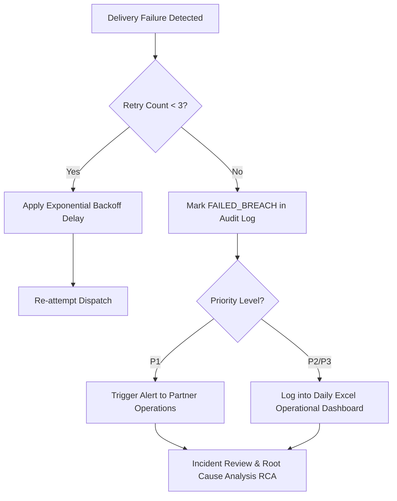

# Service Level Agreement (SLA) & Incident Escalation Matrix

**Version:** 1.4  
**Scope:** Document Operations & Partner Distribution Infrastructure  

---

## 1. SLA Performance Tiers

| Priority Tier | Classification Examples | Target Max Latency | Target Success Rate | Escalation Window |
| :--- | :--- | :--- | :--- | :--- |
| **P1 - Critical** | Regulatory notices, wire confirmations, time-sensitive disclosures | **&le; 1.5 seconds** *(Simulated)* | **&ge; 99.5%** | Immediate (< 15 mins) |
| **P2 - High** | Customer portfolio statements, loan disclosures | **&le; 3.0 seconds** *(Simulated)* | **&ge; 98.0%** | < 1 Hour |
| **P3 - Standard** | Monthly statements, informational disclosures | **&le; 6.0 seconds** *(Simulated)* | **&ge; 95.0%** | Daily Batch Review |

---

## 2. Escalation Workflow for Delivery Failures

---

## 3. Microsoft Excel Reporting Thresholds

The automated reporting system highlights metrics based on the following operational criteria:

- 🟢 **Green (Healthy):** SLA Adherence &ge; 95%, Success Rate &ge; 98%
- 🟡 **Yellow (Watchlist):** SLA Adherence 90% - 94.9%, Success Rate 94% - 97.9%
- 🔴 **Red (Action Required):** SLA Adherence < 90% or Success Rate < 94% (automatically highlighted in red in the generated `.xlsx` workbook).
